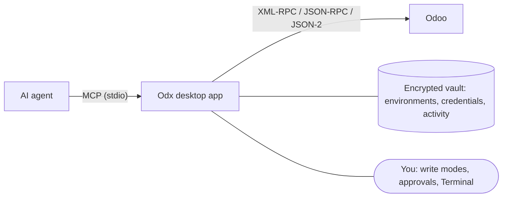

<div align="center">


# Odx

**A local desktop gateway between AI agents and Odoo.**

[](https://github.com/bencoronel/odx/releases)
[](#install)
[](LICENSE)

[Features](#features) • [Install](#install) • [Connect an agent](#connect-an-agent) • [Usage](#usage) • [Tools](#mcp-tools) • [Troubleshooting](#troubleshooting) • [Not yet available](#not-yet-available)

</div>

Odx gives AI agents such as Claude Code and Codex a set of Odoo tools over MCP, while you keep the
credentials, decide what they may write, and see every call they make.

> [!WARNING]
> **Work in progress.** Odx is a personal tool I am building to make my own work with Odoo more
> comfortable, and it is shared as is. It is in early alpha (`0.1.0-alpha`) and still lacks testing:
> expect breaking changes, rough edges and bugs.

## How it works



The agent never receives Odoo credentials. Each request goes through Odx, which checks it against the
environment's write mode, asks you when needed, sends it to Odoo, and records it.

## Features

- **Environments:** any number of Odoo environments (URL, database, login, password or API key),
  grouped by server, with tags, filters, cloning and a connection check that explains failures (DNS,
  TLS, timeout…). Each one can add Odoo context (`lang`, `allowed_company_ids`…), HTTP headers and a
  named HTTP, HTTPS or SOCKS5 (`socks5h://`) proxy on top of the global ones.
- **Protocols:** XML-RPC, classic JSON-RPC and JSON-2 (Odoo 19+), detected automatically.
- **Encrypted vault:** opened with your password, which you can change. Locks on demand, when the
  computer sleeps and when the screen locks; locking revokes pending requests. A forgotten password can
  only be solved by resetting the vault.
- **25 MCP tools:** search, read, group, inspect fields, views and access rights, compare two
  environments, download attachments, create, update, delete and call methods.
- **Write control:** read-only, approval, temporary or permanent write modes per environment. Deletes,
  including relational deletes inside `write` or `call`, always need your approval.
- **Approvals:** see what will change before confirming, decide one by one or in batches (keyboard
  included), reject with a reason for the agent, get desktop notifications; unanswered requests expire.
- **Activity:** every call with its client, environment, arguments, outcome and timing, searchable, with
  configurable retention.
- **Terminal:** an Odoo command shell, one environment per tab, saved in the vault across restarts,
  that agents can also read and drive.
- **Settings:** global context and headers, concurrency limits, request timeout, approval validity and
  activity retention.
- **Desktop:** tray, notifications, command palette (Ctrl+K), keep above other windows, light and dark
  themes, English and Spanish, self-updating AppImage.

## Install

Odx runs on Linux x86-64 with glibc 2.35 or newer (Ubuntu 22.04, Debian 12, Fedora 36 and later).
Download a package from [Releases](https://github.com/bencoronel/odx/releases).

| Package | Updates |
| --- | --- |
| `odx-linux-x86_64.AppImage` | Built in and signed: Odx offers "Update and restart" |
| `odx-linux-amd64.deb` | Odx shows a copyable command for each new version |
| `odx-linux-x86_64.rpm` | Odx shows a copyable command for each new version |

Install the AppImage, checking the download first:

```bash
version=v0.1.0-alpha.4  # a tag from the Releases page
base=https://github.com/bencoronel/odx/releases/download/$version
curl -fL -O "$base/odx-linux-x86_64.AppImage" -O "$base/odx-linux-x86_64.AppImage.sha256"
sha256sum -c odx-linux-x86_64.AppImage.sha256
chmod +x odx-linux-x86_64.AppImage
./odx-linux-x86_64.AppImage
```

Or install the `.deb` on Debian and Ubuntu (for Fedora and RHEL, use `odx-linux-x86_64.rpm` and
`sudo dnf install`):

```bash
version=v0.1.0-alpha.4  # a tag from the Releases page
base=https://github.com/bencoronel/odx/releases/download/$version
curl -fL -O "$base/odx-linux-amd64.deb" -O "$base/odx-linux-amd64.deb.sha256"
sha256sum -c odx-linux-amd64.deb.sha256
sudo apt install ./odx-linux-amd64.deb
```

On first launch, Odx asks you to create the vault password. Then add an Odoo environment in
**Environments**.

## Connect an agent

Odx must be running and unlocked while an agent works. Open **MCP → Local** in Odx:

- **Claude Code or Codex:** click to add Odx to the agent. Odx detects whether the agent is installed
  and warns you if it was registered from another path, e.g. after moving the AppImage.
- **Any other MCP client:** copy the JSON snippet from the same page. It has this shape, with the path
  of your Odx executable:

```json
{
  "mcpServers": {
    "odx": {
      "command": "/home/you/Applications/odx-linux-x86_64.AppImage",
      "args": ["mcp-stdio"]
    }
  }
}
```

To register it by hand instead:

```bash
# Claude Code
claude mcp add --transport stdio --scope user odx -- /path/to/odx-linux-x86_64.AppImage mcp-stdio

# Codex: it starts MCP servers with a reduced environment, so pass XDG_RUNTIME_DIR through
codex mcp add odx --env XDG_RUNTIME_DIR="$XDG_RUNTIME_DIR" -- /path/to/odx-linux-x86_64.AppImage mcp-stdio
```

All local agents share one profile. On the same page, choose which environments they can reach and
whether they may only read or also request writes.

> [!IMPORTANT]
> The local profile starts with access to all environments, including write requests. Narrow it before
> connecting an agent if some environments should stay out of reach. Write modes still apply.

## Usage

### Ask your agent

Once connected, ask in plain language and the agent picks the tools. For example:

> - List the Odoo environments you can use.
> - In staging, find the 10 companies with the most open invoices and show their totals.
> - Compare the product.template records between staging and production by XML ID.
> - Set the phone of res.partner 42 in staging to +34 600 000 000.

Under the hood these are MCP tool calls. For example, `search_read` with:

```json
{
  "env": "staging",
  "model": "res.partner",
  "domain": [["is_company", "=", true], ["name", "ilike", "Acme"]],
  "fields": ["name", "email", "phone"],
  "limit": 10
}
```

### Control writes

Each environment has a write mode, set in **Environments**:

| Mode | create / write / call | unlink |
| --- | --- | --- |
| Read-only | Rejected | Rejected |
| Approval | Each one waits for you in **Approvals** | Needs approval |
| Temporary | Sent directly until the timer expires, then read-only | Needs approval |
| Permanent | Sent directly until you change the mode | Needs approval |

A request waiting for approval shows the records and values it will change. Approve or reject it in
**Approvals**, alone or in a batch; a rejection can carry a reason for the agent. Changing an
environment's mode or locking the vault revokes pending requests.

A relational delete inside `write` or `call` (an x2many command that deletes records) counts as a
delete: it needs approval and each request may contain only one.

> [!NOTE]
> Writes typed in the Terminal, including those an agent runs with `terminal_run`, are confirmed in the
> Terminal tab itself: that confirmation stands in for the approval. Read-only and an expired temporary
> mode still reject them.

### Use the Terminal

The Terminal is an Odoo command shell with `psql`-style meta-commands. Each tab stays on one
environment: open a tab with **+** or Ctrl+T, pick the environment, and type `\?` for help:

```text
search res.partner -d [('name','ilike','Acme')] -f name,email,phone -l 5
write res.partner $_ {'lang': 'es_ES'}
count sale.order -d [('state','=','sale')]
read_group account.move partner_id -d [('move_type','=','out_invoice')] -f amount_total:sum
\d res.partner phone
```

`$_` holds the IDs of the last result, so `write` above updates the partners just found. Writes ask
for confirmation. Other commands include `whoami`, `cam` (access rights), `uhg` (user has group),
`metadata`, `ref`, `\set` (named ID lists), `\alias`, `\grep`, `\cols`, `\context`, `\x` and
`\next`/`\prev`. Ctrl+R searches history, Tab completes models and fields, tabs can be pinned and
reordered, and result tables can open in their own window. Agents can list tabs, read their output and run commands in them (`terminals`,
`terminal_read`, `terminal_run`, `show`).

## MCP tools

| Group | Tools |
| --- | --- |
| Environments | `envs`, `whoami` |
| Read | `search_read`, `read`, `search`, `search_count`, `name_search`, `read_group`, `ref`, `wait` |
| Inspect | `fields`, `models`, `view`, `access`, `history`, `compare` |
| Files | `download` (binary fields such as attachments, saved to a local file) |
| Write | `create`, `write`, `unlink`, `call` |
| Terminal | `terminals`, `terminal_read`, `terminal_run`, `show` |

Tools that call Odoo take `env`, an environment name from `envs` (`compare` takes `env_a` and
`env_b`), and accept an optional Odoo `context`. `search_read`, `read`, `read_group`, `history`,
`view`, `compare` and `call` can save large results to a local file with `to_file` instead of
returning them inline.

## Troubleshooting

| Message or symptom | Fix |
| --- | --- |
| `Odx unavailable: … Odx is locked; unlock it in the app` | Unlock Odx, then reconnect the MCP server in the agent (for example `/mcp` in Claude Code). |
| The agent reports the Odx server disconnected (its log shows `Odx closed the connection; check whether the app locked or exited`) | Odx locked or quit during the session. Unlock or start it and reconnect the MCP server. |
| The agent cannot reach Odx at all | Start Odx. For Codex and other clients with a reduced environment, pass `XDG_RUNTIME_DIR` as shown in [Connect an agent](#connect-an-agent). |
| `update the MCP connector together with the app` | The agent starts a different Odx version than the open app, e.g. an old copy. Restart Odx after updating, or re-add the agent in **MCP → Local**. |
| "Runs Odx from another path" | The AppImage moved or was renamed. Click to update the registration. |
| A write never reaches Odoo | Check the environment's write mode and **Approvals**. |
| JSON-2 rejects positional arguments | With JSON-2, leave `args` empty and pass named `kwargs`, with records in `kwargs.ids`. |

> [!TIP]
> **Activity** shows every call with its arguments, outcome and timing. It is the fastest way to see
> what an agent actually did.

## Not yet available

- **Server mode:** Odx as a server for remote clients over MCP and an HTTP API, with the same
  permissions, approvals and audit. The HTTP API exists in the core but the app does not start it yet.
- **Per-agent profiles:** today all local agents share one profile.
- **Automatic approval rules:** auto-approve specific methods, fields or values per environment. The
  rule engine exists in the core but has no screen yet.
- **Odoo reports:** generating and downloading PDF reports such as invoices or delivery slips.
- **Stable release:** Odx is still alpha.

More will be added as real needs come up.
